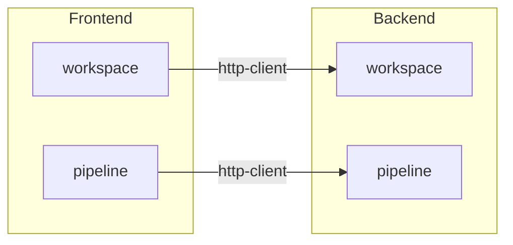

# Regras — Inventário de Módulos e Mapa de Módulos

Como varrer os módulos reais do projeto e traduzir isso em três lugares:
o inventário de `_overview.md`, o diagrama `diagrams/geral.modulos.md`, e o
diagrama condicional `diagrams/geral.classe.md`.

## 1. Varredura do inventário de módulos

Fonte: as pastas de domínio de nível superior sob a raiz de módulos do
backend (ex.: `backend/src/modules/<domain>/`) e sob a raiz de sistemas do
frontend (ex.: `frontend/src/systems/<domain>/`) — os nomes exatos das
raízes dependem do que o Passo 0 já confirmou lendo `CLAUDE.md`/o código
real; nunca assume um layout genérico não confirmado no projeto escaneado.

Para cada módulo/sistema encontrado, lê o conteúdo real da pasta (não só o
nome) para determinar:

- **Nome** — o nome literal da pasta.
- **Propósito em 1 frase** — inferido do conteúdo (nomes de rotas/endpoints,
  nomes de exports do barrel `index.ts`, comentário de topo se houver), nunca
  inventado a partir só do nome da pasta quando o conteúdo não confirma.
- **Sinal de maturidade objetivo** — lista de peças presentes/ausentes,
  nunca uma opinião. Para um módulo de backend seguindo o padrão
  routes→service→repository (ver `CLAUDE.md` do projeto se documentar esse
  padrão): marca presença de cada um dos 5 arquivos esperados
  (`<domain>.routes.ts`, `.service.ts`, `.repository.ts`, `.schema.ts`,
  `.types.ts`). "Completo" = todos presentes; "parcial" = lista exatamente o
  que falta (ex.: "parcial: sem `.schema.ts`, validação feita inline na
  rota"). Para um sistema de frontend: presença de `adapters/`, `hooks/`,
  `components/`, `types.ts`, `index.ts` (barrel) — mesmo raciocínio de
  completo/parcial com a lista exata do que falta.

Nunca infere maturidade de um módulo pelo tamanho da pasta ou número de
arquivos sozinho — é sempre "quais peças do padrão esperado (confirmado no
projeto, nunca genérico) existem de fato".

## 2. `diagrams/geral.modulos.md` — mapa de módulos

Um `flowchart` Mermaid (`flowchart TD` ou `flowchart LR`, o que couber melhor
com o número real de módulos) com dois subgrafos:

Regras:

- Uma caixa por módulo/sistema real do inventário do passo 1 — nenhum
  inventado, nenhum omitido.
- Seta sistema-frontend → módulo-backend **só** quando o código do sistema
  frontend realmente importa/chama aquele módulo (ex.: uma chamada HTTP em
  `adapters/` cujo path bate com as rotas montadas daquele módulo em
  `routes/index.ts` ou equivalente do backend) — nunca assumida só porque os
  nomes são parecidos (ex.: sistema `pipeline-robusta` no frontend não
  necessariamente aponta só para módulo `pipeline` no backend; confirma pelo
  código de fato).
- Se um sistema/módulo não tiver nenhuma seta confirmável (ex.: consome
  outro sistema, não o backend diretamente), fica sem seta — não força uma
  ligação para "não deixar solto".
- Frontmatter obrigatório e regra de regravação: ver `references/output-format.md`.

## 3. `diagrams/geral.classe.md` — condicional

Só gerar se existir modelo de domínio tipado que vá **além** das tabelas já
cobertas em `geral.banco.md` — por exemplo, DTOs de request/response, tipos
de domínio compostos, ou interfaces que agregam múltiplas entidades. Fonte:
arquivos `.types.ts`/equivalente de cada módulo do inventário.

- Uma classe/interface por tipo relevante, atributos com o tipo declarado
  no código, seta de dependência entre tipos que se referenciam entre si.
- Não duplica o que `geral.banco.md` já mostra — se um tipo é só o espelho
  1:1 de uma tabela (mesmos campos, mesmos tipos), não vira classe aqui.
- Sem tipos que se qualifiquem: pula o arquivo inteiro e registra em
  `_scan-meta.md`: "sem modelo de domínio além das tabelas — `geral.classe.md`
  não gerado."

## 4. Nunca fazer

- Nunca lista um módulo/sistema que não tem pasta real no disco.
- Nunca atribui responsabilidade de negócio a um módulo só pelo nome — sempre
  confirma abrindo pelo menos um arquivo relevante da pasta.
- Nunca desenha seta de dependência entre módulos sem confirmar a chamada
  real no código (import, fetch, rota montada) — ausência de confirmação
  vira "sem seta", nunca "seta implícita".
